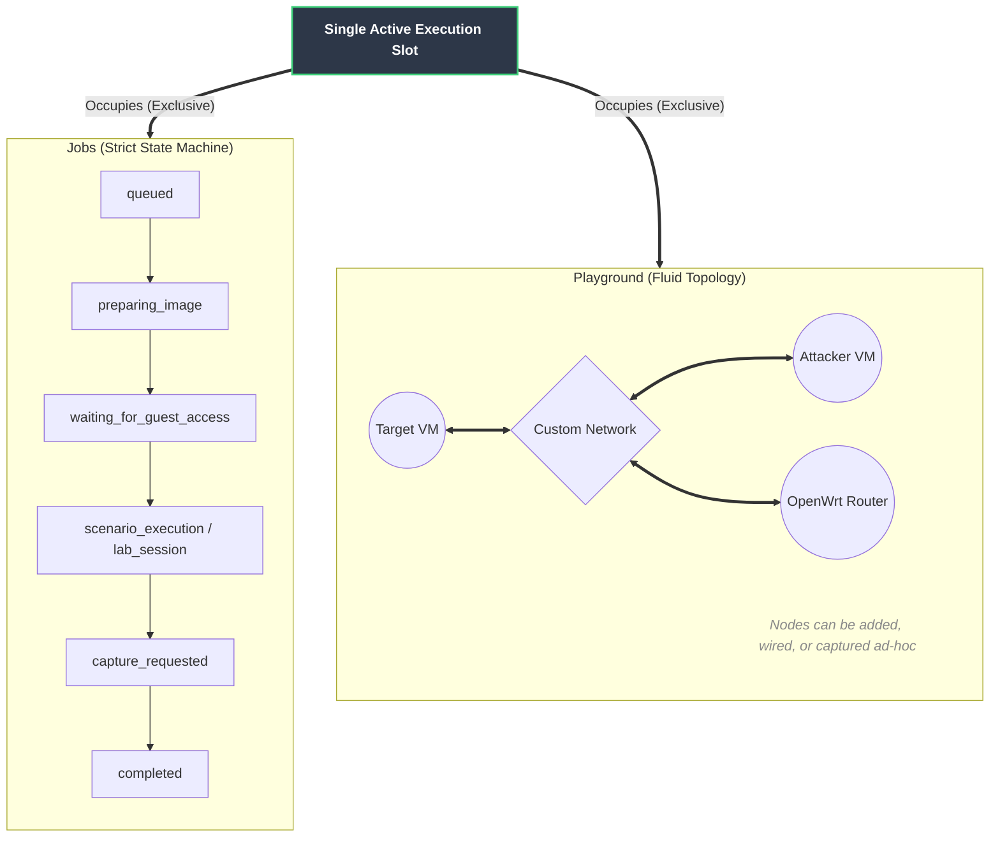

# AstinusLab — Project Overview

> Attack+forensics playground for Linux. Build vulnerable service stacks, drive attacks from attacker VM. Capture memory+disk evidence from hypervisor layer (zero guest footprint). Provision ephemeral KVM/QEMU guests, feed results to Volatility 3.

---

## 1. What AstinusLab Is

Self-hosted security-research lab. Target: blue-team builders, IR practitioners, researchers, educators. Automate memory+disk acquisition. Treat provision → run → capture → analyze → tear-down as auditable state machine.

No guest modification (no LiME/agents). Capture memory via libvirt `virDomainCoreDump` (ELF core dump). Capture disk via QCOW2 snapshots. Artifacts SHA-256 checksummed. State transitions logged.

Three workflows:

| Workflow | What it does | Who it's for |
|----------|--------------|--------------|
| **Automated acquisition** | Boot clean VM, run scenario, capture RAM/disk on trigger, destroy VM | Reproducible evidence, regression corpora, teaching |
| **Interactive lab sessions** | Provision vulnerable stack (WordPress, DVWA, GitLab CE…), boot attacker VM, work lab, capture artifacts | Hands-on exploitation, IR training, research |
| **Playground mode** | Spin up VMs (targets, attackers, OpenWrt nodes), wire across custom networks, capture interactively | Ad-hoc experiments outside rigid flows |

Portable lab packages are disabled, experimental and unaccepted. They are outside
the supported 1.0.0 scope; end-to-end, two-host, offline and performance acceptance
remains open. See [the experimental package guide](docs/user/PORTABLE_LABS.md).

---

## 2. Core Concepts

### Execution Model: Jobs vs. Playground

A key concept in AstinusLab is the **single active-job execution slot**. This execution slot can be consumed by either a structured **Job** (Automated/Interactive) or an ad-hoc **Playground** session, but never both simultaneously. 



### Jobs
**Job**: Central unit of work. Track VM lifecycle. Model boot/scenario/capture/teardown as strict state machine transitions. Illegal transitions rejected.

Path:
```
queued → preparing_image → waiting_for_guest_access → mounting_output_share
       → (running_scenario_script | provisioning_workload | waiting_for_capture → capture_requested)
       → acquiring_memory / acquiring_disk → publishing_artifact → completed
```
`failed`, `cancelled` terminal. ISF-only jobs jump `generating_isf → completed`.

### Targets
**Target**: VM template. Distro, version, base image, CPU/RAM/disk, guest user, `os_variant`. Catalog: Ubuntu 20.04/22.04/24.04, Debian 12, Fedora 40. Auto-discover new images in `images/definitions/` via `virt-inspector` or filename heuristics. Metadata saved to `.meta.json`.

### Scenarios
**Scenario**: What happens during job. Maps to execution mode:

| Scenario | Mode | Behavior |
|----------|------|----------|
| `immediate-capture` | `immediate` | Baseline Capture: Capture memory upon boot |
| `workload-sample-post-script` | `post_script` | Automated Execution: Run workload script, capture |
| `lab-session` | `manual_trigger` | Interactive Lab: Provision, snapshot, wait. Operator triggers capture via UI |

### Workloads
**Workloads**: Vulnerable service stacks for `manual_trigger` sessions (WordPress 6.4, DVWA, Full PHP Stack, OWASP Juice Shop, Basic Pentesting, GitLab CE 11.4.7). Include `install.sh`, health check, credentials, CVE tags. Optional attacker VM support ships with Kali and Parrot entries; add custom attacker catalog entries for other images.

### Network Nodes
**Network Node**: Playground VM role. OpenWrt image. Firewall/router/NAT. No cloud-init. Tiny resources (1 vCPU / 512 MB / 4 GB). Capture disabled. Purpose: shape/segment topology.

### Captures & Artifacts
- **Memory**: Raw RAM dump via `virDomainCoreDump` (ELF). VM suspended during dump, resumed after.
- **Disk**: Gzipped raw image (`.img.gz`) for jobs. Uncompressed QCOW2 for Playground captures.
- Artifacts published with filename, size, SHA-256. Available in UI/API.

### Volatility 3 Integration
Vol3 architectural. Global ISF cache keyed by kernel release + GNU build ID (prevents re-symbolization/mismatch). Host-side resolution chain: local cache → prebuilt ISF mirror → debuginfod → host fetch; if that fails, the live-guest fallback may use an existing matching DWARF-bearing `vmlinux`, debuginfod, or explicitly permitted debug-package installation from the guest. BTF-only input is not supported by `dwarf2json` and is never used for this fallback. ISF-only jobs fail fast on missing symbols. Plugin output isolated in `storage/dumps/<job_id>/vol3/`.

---

## 3. Architecture

```
┌──────────────┐     HTMX / REST      ┌────────────────────────────────┐
│  Web UI      │ ───────────────────▶ │ FastAPI app (src/astinuslab)   │
│  (Jinja2 +   │ ◀─────────────────── │ routes · services · repos      │
│   HTMX +     │     fragments        └───────────────┬────────────────┘
│   vanilla JS)│                                     │ enqueue
└──────────────┘                       ┌─────────────▼──────────────┐
                                        │  Celery worker             │
                                        │  orchestrator state machine│
                                        └─────────────┬──────────────┘
                       libvirt / KVM ◀────────────────┤
                       virDomainCoreDump, QCOW2,       │
                       cloud-init, QGA, virtiofsd      │
                                        ┌──────────────▼──────────────┐
                                        │  SQLite (jobs, events,      │
                                        │  runtimes, ISF artifacts)   │
                                        └─────────────────────────────┘
```

**Backend stack**: Python 3.12/3.13, FastAPI, Uvicorn, Celery 5.3+ (SQLite broker/results), SQLAlchemy 2.0 (SQLite WAL), `libvirt-python`. Pydantic v2 validation. PyYAML catalog. Jinja2 cloud-init templates.

**Modules**:
- `orchestration/runners/boot_capture_runner.py`: Scenario-driven job-run flow. Coordinate provision, setup, capture, ISF build (wired via `job_run_deps.py`).
- `virtualization/vm_lifecycle.py`: QCOW2 overlays, cloud-init seed ISO, libvirt boot, IP acquisition.
- `virtualization/guest_wait.py`: QGA polling, SSH check, metadata collection.
- `forensics/capture_support.py` / `forensics/memory_dump.py`: Core dump, disk capture, checksum, publish.
- `playground/`: Interactive sessions, live metrics, topology persistence.
- `forensics/vol3_support.py` / `orchestration/runners/isf_matrix_runner.py` / `forensics/symbols/`: ISF provider chain, batch matrix testing.
- `catalog.py`: YAML parsing, image auto-discovery.
- `job_status.py` / `repositories.py`: State vocabulary and transition graph, enforced by repositories.

**Data model**: `Job`, `JobEvent`, `JobRuntime`, `HostAction`, `ISFArtifact`, `PlaygroundSession`, `JobVM`, `JobNetwork`, `JobVMNic`, `PlaygroundTopologyLayout`, `AppSetting`. Evidence: `Case`, `Acquisition`, `AcquisitionEvent`, `Artifact`, `Report`.

**Deployment**: Release (systemd services via `ops/deploy/install.sh`), Development (`astinuslab.sh`). Config in `astinuslab.toml`.

> **Security posture:** Local tool. Binds loopback. Optional single-admin API auth. Non-loopback requires auth/unsafe override. Add TLS/VPN/reverse-proxy for network exposure.

---

## 4. The User Interface

Server-rendered web app. Terminal/forensic aesthetic. Jinja2 + HTMX + vanilla JS + modular CSS (no bundler).

### Visual Design Language
- Dark mode first (light mode via `localStorage`).
- Palette: `#0a0b0d` background, `#3ecf7a` primary. Semantic accents.
- Typography: Inter (UI), Fira Code/Mono (logs). 13px base size.
- Geometry: Minimal radii, flat fills, SVG accents. Instrument panel style.

### Layout & Navigation
220px left sidebar (workspace/system nav). Top engagement bar (section + clock).

### Primary Screens

| Screen | Purpose |
|--------|---------|
| **Jobs Dashboard** | Table of recent jobs. HTMX auto-refresh 5s. |
| **New Job Wizard** | 2 steps: Target/Scenario selection, Configure resources/workload/capture. |
| **Job Detail** | Live polling. Stepper, VM runtimes, lab control, service access, artifact downloads. |
| **Playground** | Draggable SVG topology map. VM cards, live metrics, capture console, zoom controls. |
| **Admin panels** | Storage, Logs, Security (`/ssh-keys`), Images, Workloads, Dumps. |

### Notable Components
- Resource sliders: Input + range track.
- Workload selector: Searchable card grid.
- Phase stepper: Adapts steps to execution mode.
- VM runtime cards: Power controls, capture flags.
- SSH command blocks: Copy-to-clipboard.
- Status badges & spinners: Semantic colors.
- Modals: Blurred backdrop, accessible dialogs.

### Accessibility
Semantic inputs, ARIA labels, focus rings, keyboard support, `data-confirm` guards. Internationalization (`i18n.py`).

---

## 5. The User Experience

### Creating automated acquisition
Select target/scenario. Configure resources. Submit. UI redirects to Job Detail. Phase stepper tracks boot → access → capture → publish. Download links appear. VM auto-destroys.

### Running interactive lab
Select workload (+ optional attacker VM). Provision, snapshot, wait. UI shows URLs, credentials, SSH commands. Exploit lab. Trigger capture via UI. Reset Lab button reverts snapshot.

### Working in Playground mode
Auto-create session on first VM/network. Create custom networks. Spawn VMs. Arrange topology map. Live metrics. Trigger per-VM captures. Destroy session cleans up everything.

### Design philosophy
Target expert operators. Dense info, transparency, trust. No silent actions. State transitions/artifacts visible.

---

## 6. V1 Scope and Roadmap

V1 scope:
- Localhost/trusted-local default; optional single-admin API auth.
- UI playground + JSON recipe import/export for repeatable labs; broader YAML recipe authoring remains roadmap.
- Web-app targets: WordPress, DVWA, Juice Shop, GitLab.
- Attacker VM support.
- Memory+disk captures (manifest + SHA-256 sidecars).
- Volatility 3 memory analysis of Linux targets using Linux ISFs. Windows PDB/catalog handling is experimental groundwork, not a supported 1.0.0 workflow.
- Concurrency: SQLite-backed workers remain single-host/single-runner; VM capacity follows host resources and the optional `max_concurrent_vms` admission limit.

Roadmap:
- Portable local lab packages: retained as disabled, experimental code outside supported 1.0.0 scope until P1–P3 acceptance passes on one candidate. Locked/unlocked format labels do not establish release acceptance.
- Automated Windows guest provisioning parity.
- Continuous live telemetry.
- Richer generated reports beyond the Volatility summaries and plugin reports already published.
- Hostile-guest hardening controls.

---

## 7. REST API

Actions backed by REST API under `/api/v1/`. Key endpoints:

```
GET    /api/v1/jobs                          # list jobs
POST   /api/v1/jobs                          # create a job
GET    /api/v1/jobs/{id}                     # job detail
DELETE /api/v1/jobs/{id}                     # delete job record
GET    /api/v1/jobs/{id}/artifact            # download RAM dump
GET    /api/v1/jobs/{id}/disk-artifact       # download disk image
POST   /api/v1/jobs/{id}/capture             # trigger capture (manual_trigger)
POST   /api/v1/jobs/{id}/acquire-memory-dump # deprecated alias of /capture
POST   /api/v1/jobs/{id}/cancel              # cancel job
POST   /api/v1/jobs/{id}/retry               # retry failed job
POST   /api/v1/jobs/{id}/reset-lab           # restore VM from snapshot
GET    /api/v1/jobs/{id}/lab-info            # service URLs and credentials
GET    /api/v1/targets                       # target catalog
GET    /api/v1/scenarios                     # scenario catalog
GET    /api/v1/workloads                     # workload catalog
GET    /api/v1/acquisitions                  # acquisition records
GET    /health                               # health check
```

Docs: `docs/api/endpoints.md`.

---

## 8. Technology Summary

| Layer | Choice |
|-------|--------|
| Language | Python 3.12 / 3.13 (tested matrix) |
| API | FastAPI + Uvicorn |
| Async execution | Celery 5.3+ (SQLite broker & result backend) |
| Persistence | SQLAlchemy 2.0 over SQLite (WAL mode) |
| Validation | Pydantic v2 |
| Virtualization | libvirt / KVM / QEMU, cloud-init, QGA, virtiofsd |
| Memory capture | `virDomainCoreDump` (ELF core dump) |
| Disk capture | QCOW2 snapshot / `qemu-img` convert |
| Forensic analysis | Volatility 3 with a build-ID-keyed ISF cache |
| Frontend | Jinja2 + HTMX + vanilla JS, hand-written modular CSS (`@import` layers), no bundler |
| Catalog | YAML (targets, scenarios, workloads, attackers, network nodes, profiles) |
| Docs | MkDocs Material |
| Deployment | systemd units (release) or `astinuslab.sh` (development) |
| License | Volatility Software License 1.0 |

---

## 9. Repository Layout

```
AstinusLab/
├── src/astinuslab/     FastAPI app, playground, forensics, catalog
│   └── web/            Jinja2 templates, partials, static CSS/JS
├── tests/              Python, shell, and browser test suites
├── config/catalog/     targets/scenarios/workloads/attackers/nodes/profiles YAML
├── guest/              cloud-init templates, guest scripts, workload installers
├── vol3/               fetch scripts and ISF symbol cache; external tools stay operator-owned
├── ops/deploy/         install/upgrade/uninstall implementations
├── ops/host/           libvirt storage & ACL helpers
├── ops/images/         operator-facing image download helpers
├── ops/systemd/        installed service unit templates
├── docs/               MkDocs site
├── storage/            runtime state (DB, dumps, caches, logs)
├── astinuslab.sh       development-mode launcher
└── astinuslab.toml     configuration
```
